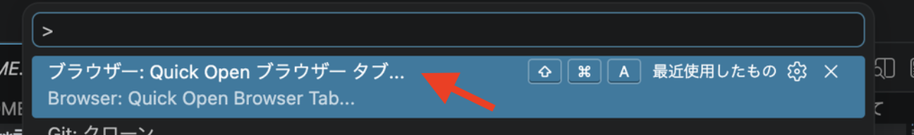
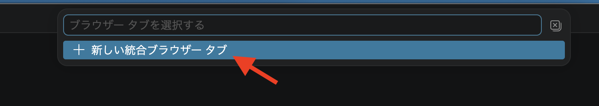
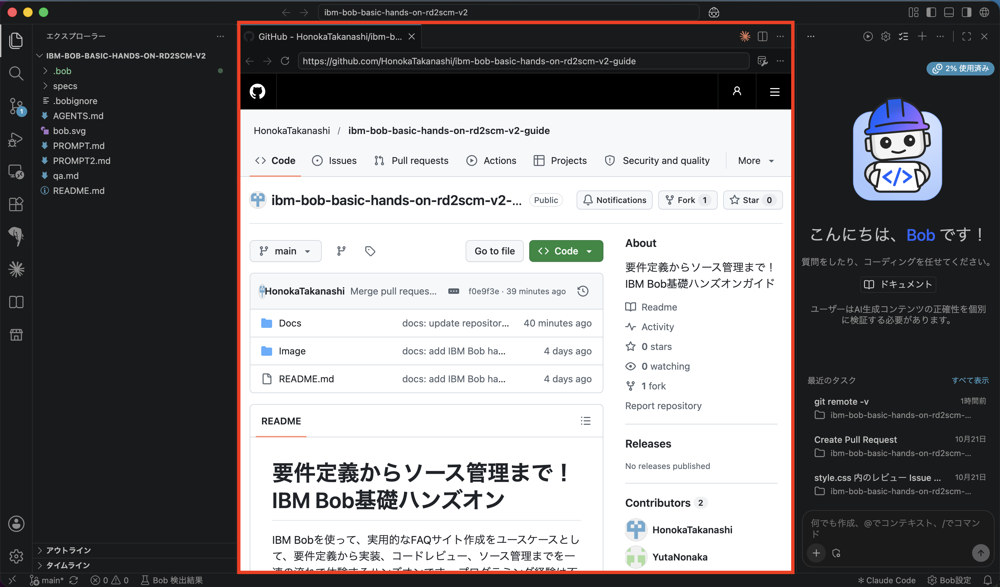

# Bob IDE 内でガイドを表示する手順

## 目的

ガイドを Bob の IDE 内に表示すると、ブラウザとの切り替えなしに、ガイドを見ながら同じ画面でハンズオンを進められます。

## 概要

1. URLをコピー
2. コマンドパレットを開く
3. `Quick Open ブラウザー タブ` と入力
4. URLを貼り付けてEnter
5. Bob内にガイドが表示

## 手順

### 1. URL をコピーします

```
https://github.com/HonokaTakanashi/ibm-bob-basic-hands-on-rd2scm-v2-guide
```

### 2. コマンドパレットを開きます

- Mac: `Cmd + Shift + P`
- Windows/Linux: `Ctrl + Shift + P`

### 3. コマンドを検索します

1. 入力欄に `Quick Open ブラウザー タブ` と入力します。「ブラウザー: Quick Open ブラウザー タブ...」が出たら選びます。



2. 「新しい統合ブラウザー タブ」が出たら選びます。



英語の候補が出ない場合は `ブラウザ` や `open browser` でも試してください。

### 4. URL を貼り付けます

1. 「URL を入力」の欄に、コピーした URL を貼り付けます。
2. `Enter` を押します。

### 5. 表示を確認します

Bob のエディタ領域に新しいタブが開き、GitHub のガイドが表示されます。
ガイドを見ながら、横の分割画面で作業できます。



## うまくいかない場合

- **候補が出ない場合**: Simple Browser 系のコマンドが無効になっているか、名称が違う可能性があります。以下の方法で開いてください。
  1. 通常のブラウザで URL を開きます。
  2. Bob のチャットに URL を貼ります。チャット内の URL はクリックすると既定のブラウザで開きます。これはドキュメントで確認できた機能です。
- **GitHub のページが表示されない場合**: 組み込みブラウザでは表示に制限がかかることがあります。その場合は通常のブラウザで開いてください。
