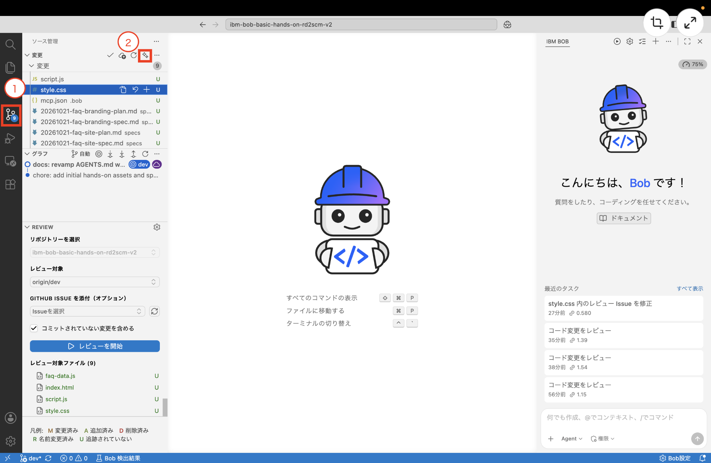
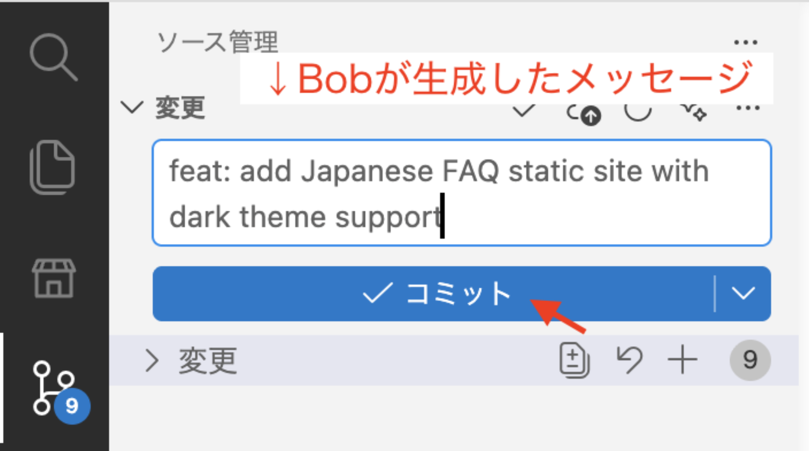
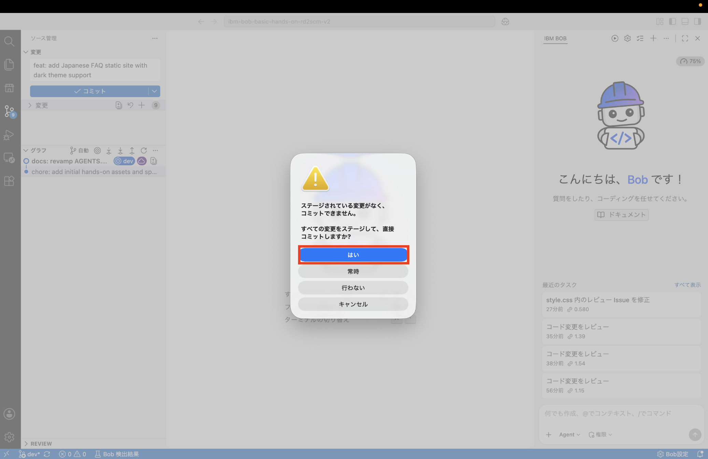
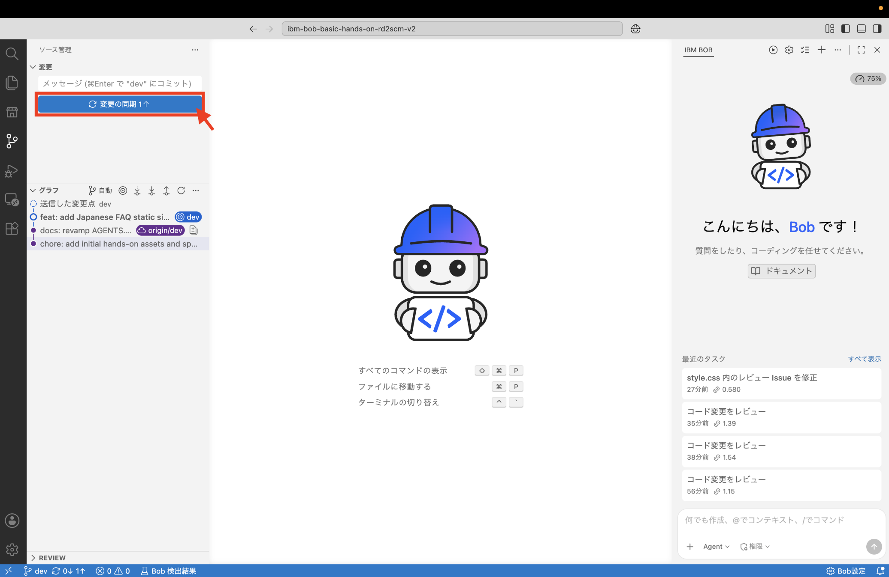
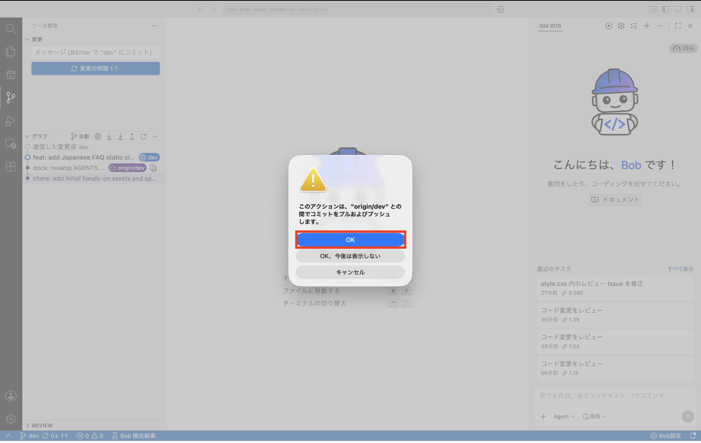
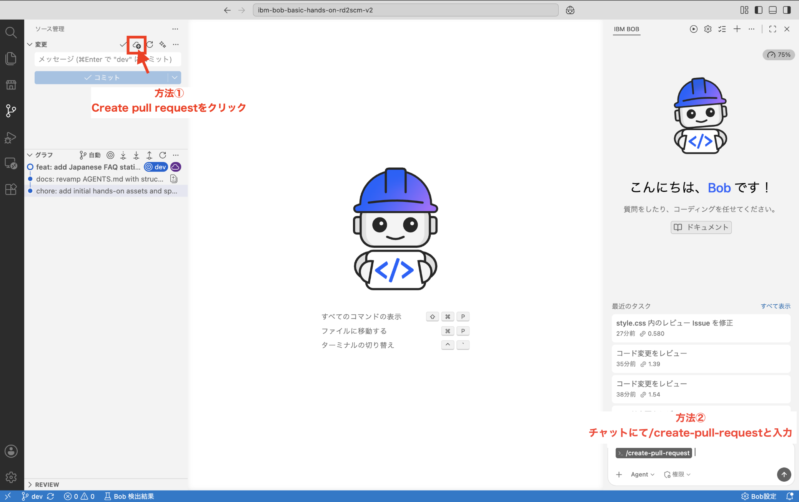
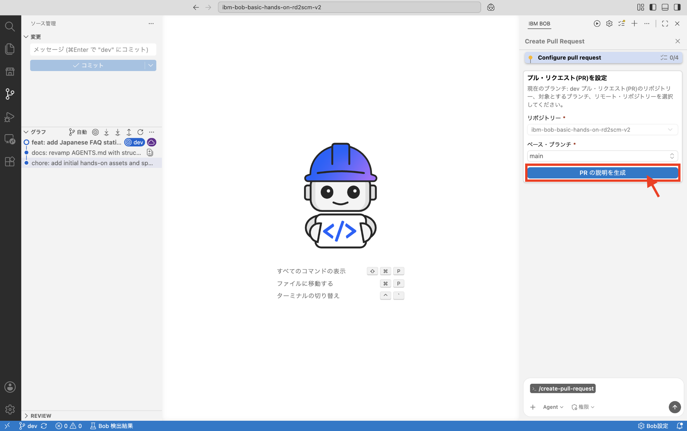
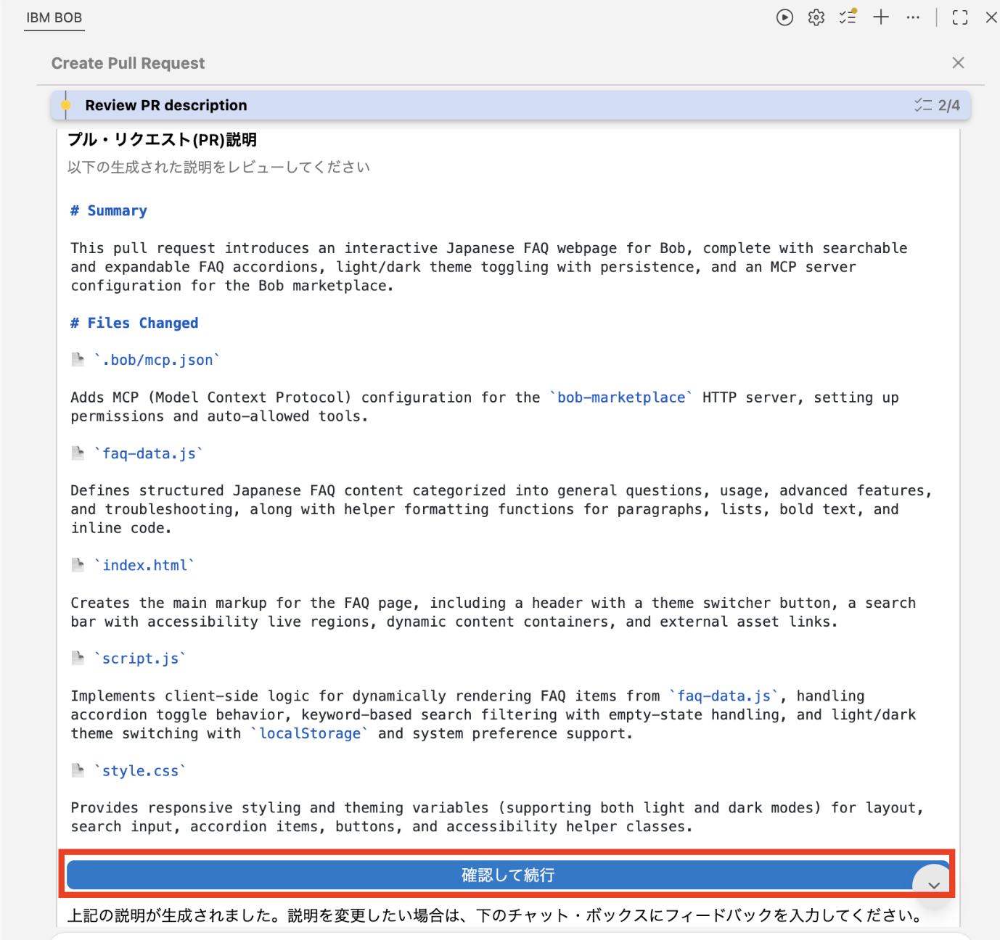
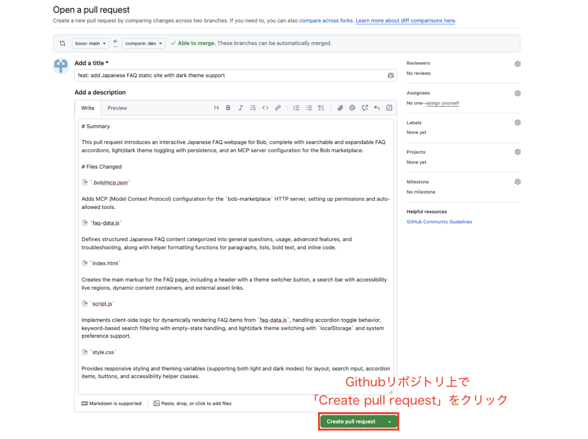
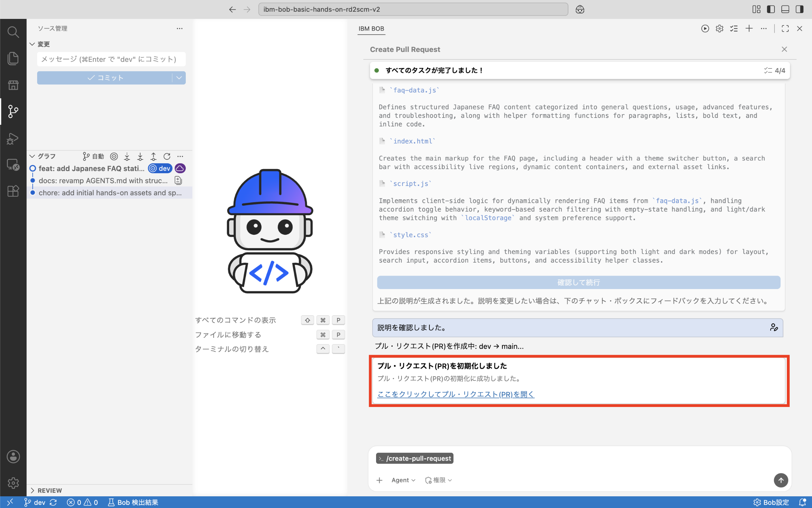

# LAB4 - ソース管理

<!-- 可能であれば差し込む
[プログレスバー画像: LAB1 → LAB2 → LAB3 → LAB4（強調）]


視覚的説明図:
- Bobキャラクターのイラスト
- 吹き出し: 「Lab3までで作成・改善したコードを、コミットメッセージとプルリクエストで管理します」
- スクリーンショット: Git差分とコミットメッセージ作成画面
-->

Lab3までで作成したFAQサイトのソースをGitで管理します。

---

## セッションの切り替え

「新しいタスクを開始」を押して、セッションを切り替えてください。

## GitHubリポジトリへの差分反映
### 1. コミットメッセージの作成

IBM Bobのコミットメッセージ作成支援機能を使います。

#### 手順：

1. 左側のアクティビティバーから「ソース管理」パネルを開く
2. コミットメッセージ入力欄の「✨」アイコン（generate commit message）をクリック
3. Bobが差分を分析してコミットメッセージを提案



#### Bobが提案するメッセージの例：

```
feat: add Japanese FAQ static site with dark theme support
```

#### ユーザーのアクション：

- 提案されたメッセージを確認
- 必要に応じて編集

### 2. 変更をコミット

変更をコミットします。

#### 手順：

1. ソース管理パネルで「コミット」をクリック



2. ステージングの確認ダイアログが表示されたら、「はい」をクリック



### 3. 変更をリモートにプッシュ

コミット後、変更をGitHubにプッシュします。

#### 手順：

1. ソース管理パネルで「変更の同期」をクリック



2. プルおよびプッシュの確認ダイアログが表示されたら、「OK」をクリック



※GitHubの認証を求められた場合は認証処理を進めてください。

### 4. プルリクエストの作成

IBM Bobのプルリクエスト作成支援機能を使います。
プルリクエストの作成には2つの方法があります。

#### 方法1: Bob IDEのメニューから作成

1. ソース管理パネルの「Create pull request」（雲のアイコン）をクリック
2. Bobが変更内容を分析してPR説明文を生成

#### 方法2: スラッシュコマンドで作成

1. チャット画面で `/create-pull-request` と入力
2. Bobが変更内容を分析してPR説明文を生成



#### PR説明文の生成：

1. 「プル・リクエスト(PR)を設定」パネルでリポジトリーとベースブランチ（main）を確認し、「PR の説明を生成」をクリック



2. Bobが変更内容を分析して、PR説明文を提案します。

#### 提案される説明文の例：

```markdown
## Summary
This pull request adds a new FAQ site for Bob, an AI-powered coding companion. The site includes a comprehensive FAQ section with questions and answers organized into categories (General, Usage, Advanced Features, and Troubleshooting), along with theme switching functionality and responsive design.

## Files Changed
📄 Hands-on/faq-site/bob.svg

Adds the Bob logo as an SVG file. The logo features a robot/coding assistant character with a gradient color scheme (blue to purple) matching the Bob brand colors. The SVG includes detailed styling with multiple layers for the head, body, and coding-related visual elements.

📄 Hands-on/faq-site/index.html

Creates the main HTML structure for the Bob FAQ site. The page includes:

- A header with the Bob logo, title, and theme toggle button
- Four FAQ sections covering general information, usage instructions, advanced features, and troubleshooting
- Collapsible FAQ items with questions and detailed answers
- A footer with copyright information
- Japanese language content (lang="ja") with comprehensive information about Bob's capabilities, usage, and safety considerations

📄 Hands-on/faq-site/script.js

Implements the interactive functionality for the FAQ site:

- Accordion-style expand/collapse behavior for FAQ items
- Theme switching between light and dark modes with localStorage persistence
- Accessibility features including ARIA attributes for screen readers
- Event listeners for user interactions with FAQ questions and theme toggle button

📄 Hands-on/faq-site/styles.css

Provides comprehensive styling for the FAQ site including:

- CSS custom properties for theme colors supporting both light and dark modes
- Bob brand colors (primary blue #0f62fe and purple gradient)
- Responsive design with media queries for mobile, tablet, and desktop viewports
- Smooth transitions and animations for interactive elements
- Accessible styling for code snippets, lists, and text content
- Modern design with shadows, rounded corners, and hover effects
```

#### PR説明文の確認と続行：

1. 生成された説明文を確認・編集し、「確認して続行」をクリック



2. 「ここをクリックしてプル・リクエスト(PR)を開く」をクリックしてGitHubを開く



3. GitHub上で「Create pull request」をクリックしてPRを作成



## Lab4タスクの完了

### Lab4の完了

コミットメッセージとプルリクエストの作成が完了しました！  
IBM Bobを活用することで、変更内容を適切に記録し、チームに共有できます。

**完了条件:**
- コミットが作成された  
- コミットメッセージが適切
- リモートブランチに変更がプッシュされた  
- GitHubリポジトリで変更が確認できる
- PRタイトルが適切  
- PR説明文が分かりやすい  
- 変更ファイルが正しく含まれている  
- レビュー依頼ができる状態

---

## 次のステップ

これでLab1〜Lab4のすべてが完了しました！  
要件定義から実装、レビュー、ソース管理まで、一連の開発フローを体験できました。

→ [まとめと次のステップ](https://r-nakayamasan.github.io/bob-workshop-draft/06_summary/)

---

## 関連リンク

- [READMEに戻る](../README.md)
- [準備と設定ガイド](preparation-and-setup.md)
- [コミットメッセージ機能](https://bob.ibm.com/docs/ide/features/commit-messages)
- [プルリクエスト機能](https://bob.ibm.com/docs/ide/features/pull-requests)